# Implemented Database ERD

This diagram describes the database currently implemented by the Python SQLAlchemy models and Alembic migrations. It shows database tables, key fields, and foreign-key relationships only.

```mermaid
erDiagram
    users ||--o{ policies : owns
    policies ||--o{ insured_persons : insures
    insurance_plans ||--o{ insurance_plan_versions : has_versions
    insurance_terms_versions ||--o{ insurance_plan_versions : governs
    insurance_terms_versions ||--o{ knowledge_documents : documents
    insurance_plan_versions ||--o{ plan_variants : offers
    plan_variants ||--o{ policies : selected_by
    plan_variants ||--o{ variant_coverages : defines
    coverage_types ||--o{ variant_coverages : classifies

    users {
        integer id PK
        uuid auth_user_id UK "nullable"
        varchar email UK "max 255"
    }

    policies {
        integer id PK
        varchar policy_number UK "max 50"
        integer user_id FK
        integer plan_variant_id FK
        varchar trip_purpose "max 50"
        varchar declared_sport_category "max 50"
        date start_date
        date end_date
        varchar status "max 30"
        numeric price_paid "12,2"
        varchar currency "max 3"
        timestamptz created_at
        timestamptz updated_at
    }

    insured_persons {
        integer id PK
        integer policy_id FK
        varchar name "max 150"
        date date_of_birth
    }

    insurance_plans {
        integer id PK
        varchar name UK "max 50"
    }

    insurance_plan_versions {
        integer id PK
        integer plan_id FK
        integer terms_version_id FK
        integer version
        date valid_from
        date valid_to "nullable"
    }

    insurance_terms_versions {
        integer id PK
        varchar code UK "max 50"
        date valid_from
        date valid_to "nullable"
    }

    plan_variants {
        integer id PK
        integer plan_version_id FK
        varchar territory "max 30"
        varchar sport_category "max 50; nullable"
    }

    coverage_types {
        integer id PK
        varchar code UK "max 50"
        varchar name "max 150"
    }

    variant_coverages {
        integer id PK
        integer plan_variant_id FK
        integer coverage_type_id FK
        numeric limit_amount "15,2"
        varchar currency "max 3"
    }

    knowledge_documents {
        integer id PK
        integer terms_version_id FK
        varchar title "max 255"
        varchar file_name "max 255"
        varchar storage_path UK "max 500"
        varchar checksum UK "max 64"
        varchar processing_status "max 20"
        timestamptz created_at
    }
```

## Key constraints

- Unique fields: user email and auth_user_id; policy number; plan name; terms-version code; coverage-type code; document storage path and checksum.
- Composite unique constraints: insurance plan version on (plan_id, version); plan variant on (plan_version_id, territory, sport_category); variant coverage on (plan_variant_id, coverage_type_id). The plan-variant constraint treats NULL sport categories as equal in PostgreSQL.
- users.auth_user_id is a nullable unique UUID mapped to Supabase Auth. The database does not define a foreign key to Supabase's auth schema.
- A policy references its plan_variant; coverage limits come through that shared plan variant. The current schema does not store a policy-specific coverage snapshot.
- knowledge_documents stores document metadata and processing status. Document chunks, embeddings, conversations, messages, and citations are not yet implemented.

