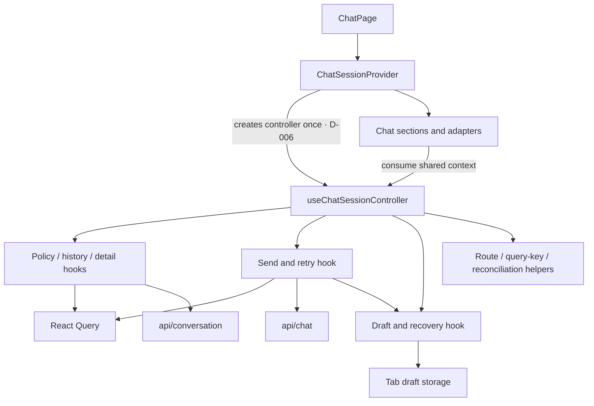

# Chat hook namespace design

**Status:** Approved by the user on 2026-11-23, implemented, and verified as a folder-organization change.

## Intent

Make the frontend hook directory reflect the cohesive chat feature. Routes, pages, components, forms, and query keys already use `chat`; at review time the complete chat-session workflow was grouped under `frontend/src/hooks/conversation/`.

## Goals

- Move the full flat hook/helper folder from `frontend/src/hooks/conversation/` to `frontend/src/hooks/chat/`.
- Keep focused hook responsibilities and the existing file/function names, including resource-specific `useConversation` and `useConversationHistory`.
- Update source imports, barrels, test module paths, and current documentation references.
- Preserve runtime behavior and state ownership.

## Non-goals and constraints

- Do not merge or rename `frontend/src/api/chat/` and `frontend/src/api/conversation/`; these remain separate API contracts.
- Do not rename conversation types, hooks, endpoints, routes, or query keys.
- Do not change React Query, tab draft/recovery, idempotency, ownership, or provider/controller behavior.
- Keep the existing narrow hook export surface: `frontend/src/hooks/chat/index.ts` exports `useChatSessionContext`; the root hooks barrel re-exports `./chat`.
- Keep the folder flat for now; no speculative nested folders or generalized hook framework.

## Approaches considered

1. **Move all current contents to `hooks/chat/` (selected).** Matches the single user-facing feature and the user's stated naming preference while preserving resource names and responsibilities.
2. **Split chat and conversation hooks into separate folders.** Rejected for now: the chat session controller composes conversation reads, their query keys are chat-scoped, and no separate conversation UI is observed.
3. **Keep the mixed folder named `hooks/conversation/`.** Rejected: it conflicts with the user's preference and the existing `pages/chat`, `components/chat`, and `forms/chat` organization.

## Proposed shape

```text
frontend/src/
  pages/chat/
  components/chat/
  forms/chat/
  hooks/
    auth/
    chat/               # moved feature hooks and helpers; same names and flat layout
    health/
  api/
    chat/               # unchanged API operations
    conversation/        # unchanged conversation/policy API operations
```

## Responsibility flow



The chat feature remains composed by one provider/controller. React Query owns backend read/cache state, the send hook owns mutation/retry coordination, and tab storage owns editable drafts and immutable pending recovery payloads (D-001, D-002, D-006).

## Review focus and safeguards

- Keep API resource boundaries distinct from frontend feature grouping.
- Preserve account-scoped query keys and server-side ownership checks; directory names do not grant authorization.
- Preserve the provider as the only controller owner and all existing manual retry/recovery safeguards.
- Keep transcripts and auth tokens out of tab draft storage; no storage or privacy boundary changes are part of this proposal.
- Preserve current export behavior and avoid changing unrelated auth/health hooks.

## Evidence and limits

The initial review observed `frontend/src/hooks/conversation/`; it is now `frontend/src/hooks/chat/`. Other grounding includes `frontend/src/app/router.tsx`, `frontend/src/components/chat/`, `frontend/src/forms/chat/`, `frontend/src/api/chat/`, `frontend/src/api/conversation/`, and chat-scoped query keys. The approved project rules are in `docs/knowledge/frontend-architecture.md` and `docs/knowledge/decisions.md` (D-001, D-002, D-006). Verification on 2026-11-23: `npm test` passed 42/42, lint passed, and the production build passed to a temporary output directory. React/Emotion test-renderer warnings and the existing large-chunk advisory remain; browser verification was not run because no UI behavior changed.
